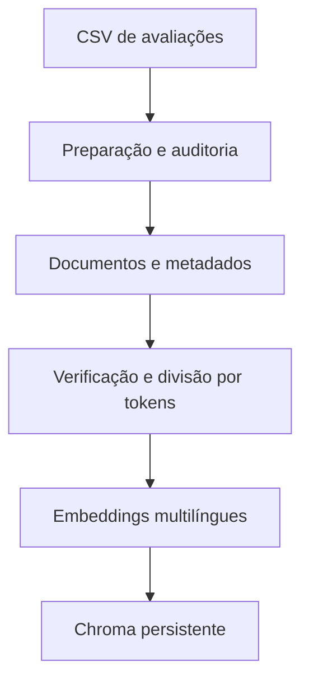
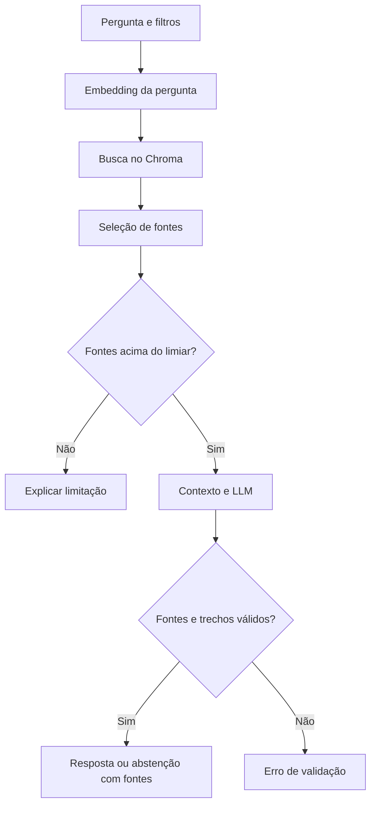

# Arquitetura

## Ingestão

O CSV original é preservado. Os documentos preparados contêm identificador técnico,
review_id, order_id, nota, data e texto. A auditoria registra contagens e hash.
Uma avaliação pode produzir mais de uma unidade vetorial quando exceder o limite
do modelo; as unidades mantêm o mesmo parent_id. A construção é executada fora do
ciclo de perguntas e pode retomar lotes persistidos.

## Consulta

O filtro de nota restringe a recuperação. Os candidatos são deduplicados para o
contexto e limitados a até cinco fontes; similaridade inferior ao limiar é excluída.
O modelo de geração recebe somente pergunta, escopo e fontes selecionadas com rótulos.
Pode reconhecer falta de suporte mesmo quando há documentos próximos no espaço vetorial.

## Limites e operação

O SDK envia o contexto selecionado à Gemini API; a chave fica em configuração local.
Falhas 400/403/404/429/5xx são tratadas como erros técnicos. Uma falha do serviço não
vira uma afirmação de ausência de dados.

A validação de IDs e trechos não comprova a relação semântica entre evidência e
afirmação. O comportamento depende da recuperação, do prompt, do modelo e da revisão
dos resultados. Logs locais e metadados permitem investigar esses componentes.

O índice ativo é indicado por `chroma_db/active_index.json`. A interface informa
se a população é uma amostra. O manifesto registra a configuração usada.
